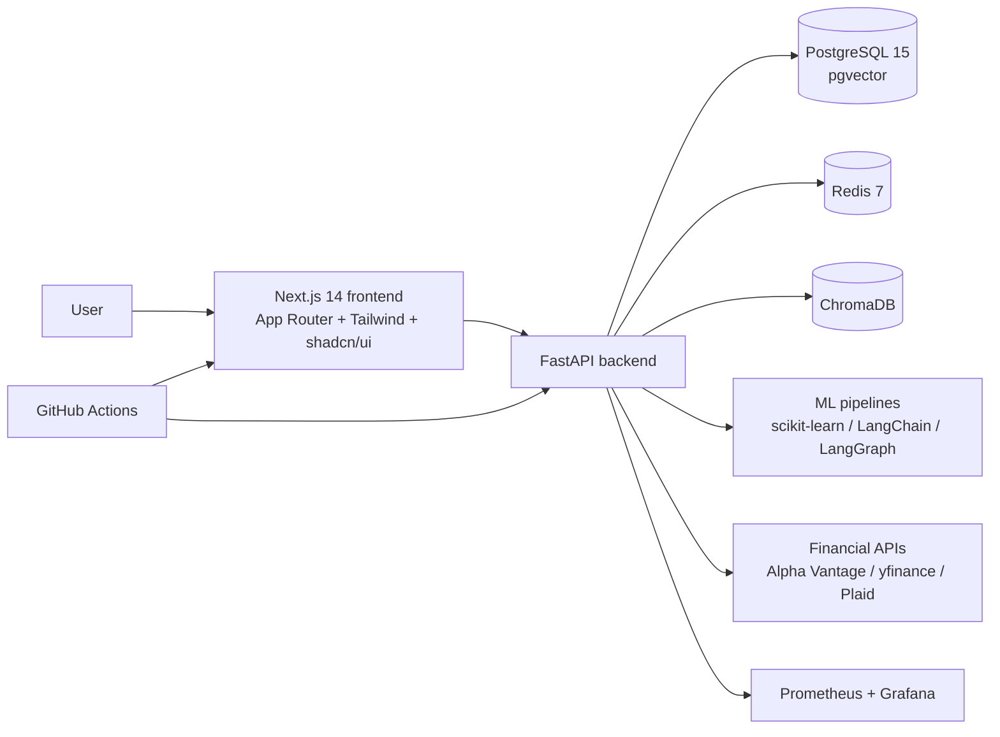

# Architecture

## Initial system shape

## Components

- Frontend: Next.js 14 App Router, TypeScript, Tailwind, shadcn/ui; initially a placeholder page.
- Backend: FastAPI with a `/health` endpoint; domain services will be added phase by phase.
- Database: PostgreSQL 15 with the pgvector extension for relational and embedding storage.
- Cache and jobs: Redis 7; Celery is planned for background work.
- Vector store: ChromaDB for the roadmap's local-first RAG layer.
- ML/AI: LangChain/LangGraph, OpenRouter, Ollama, scikit-learn, QuantLib, pandas-ta as specified by the roadmap.
- Monitoring: Prometheus and Grafana are reserved in the Compose stack for later metrics wiring.
- Infrastructure: Docker Compose for local services and GitHub Actions for CI/CD.

## Phase 1 storage

- `ingestion_records`: append-only raw-normalized JSONB records with `source`, `payload`, and `ingested_at`; the scheduler currently writes fixture-verified records and is ready for live connector payloads.
- Connector modules live under `backend/ingestion/connectors`; Pydantic models and sanity validation are shared across sources.
- Phase 2 data engineering lives under `backend/data_engineering`: pure cleaning transforms, return/volatility/ratio features, and SHA-256 content-addressed manifests under `data_versions/`.
- Phase 3 classical ML lives under `backend/ml`; it uses a leakage-safe chronological split and writes model artifacts plus measured metrics under `models/`.
- Phase 4 RAG lives under `backend/rag`; real SEC HTML filings are extracted into traceable chunks, embedded into fixed 256-dimensional vectors, stored in `rag_chunks`, and retrieved through pgvector with citation metadata.
- Phase 5 agents live under `backend/agents`; seven specialists consume verified source/artifact state, Report Writer aggregates them, and the orchestrator preserves conflicting stances.
- Phase 6 explainability: shared `AgentResponse` schema (Pydantic) under `backend/agents/schemas.py` enforces evidence, confidence, sources, assumptions, limitations on all 8 agents; confidence computed from real signals per agent; sample outputs include full explainability metadata.
- Phase 7 frontend: Next.js 14 App Router pages under `frontend/app/` (Dashboard, Company Analysis, Portfolio, News, Watchlists, AI Chat, Alerts, Backtesting); all wired to FastAPI endpoints (`/orchestrate`, `/market-data`, `/news`, `/macro`, `/agents`); shared `Navigation` component; static build passes.
- Phase 9 deployment: GitHub Actions CI/CD (`.github/workflows/ci.yml`) with backend-test, frontend-build, docker, deploy-backend, deploy-frontend jobs; production `docker-compose.prod.yml` with 6 services (postgres, redis, backend, frontend, prometheus, grafana); Prometheus metrics at `/metrics` (http_requests_total, orchestration_duration_seconds, agent_confidence); Grafana dashboard with 6 panels; DB init script (`infra/init-db.sql`) with pgvector, ingestion_records, rag_chunks, market_bars, macro_observations, news_items tables; multi-stage Dockerfiles for backend (port 8001) and frontend (standalone output).
